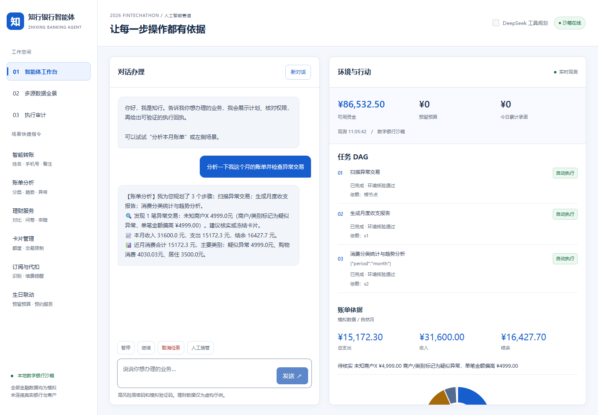

# 知行银行智能体

2026深圳国际金融科技大赛 微众银行金融科技大学生挑战赛，国内人工智能赛道。

知行通过自然语言生成带依赖关系的银行任务计划，用独立安全策略控制每次写操作，并从沙箱状态验证执行回执。覆盖智能转账、账单分析、理财操作、卡片管理、订阅代扣、生日联动六个方向。全部金融数据为模拟，未连接真实银行、短信或商户。



## 评审快速开始

从GitHub下载ZIP并解压，或克隆仓库后进入项目根目录：

```powershell
git clone https://github.com/estenbernhardpj109/xioaxiaoxianshengGZC.git
cd xioaxiaoxianshengGZC
```

在本目录运行（Python 3.10及以上，无需安装后端依赖）：

```powershell
python backend/server.py --port 8011
```

浏览器访问 http://127.0.0.1:8011 。高风险演示密码为 `123456`，一次性验证码在确认窗中显示，模拟身份因子有效期180秒。系统仅监听本机。不是生产身份认证。

依次体验：

1. “分析一下我这个月的账单并检查异常交易”
2. “给李婷转500元，备注餐费” 并确认
3. “给王浩转1001元” 核对详情并完成强验证
4. “推荐稳健理财”“风险评估 A B A”“申购货币基金100元”
5. “挂失我的信用卡”“查看我的订阅续费”“取消腾讯视频会员订阅”
6. “李婷2026-11-10生日，预留1000元买鲜花蛋糕”
7. 点击“多源数据全景”查看12种数据视图，点击“执行审计”查看证据链

暂停、继续、取消任务、人工接管均为可输入指令。取消和回退仅恢复本地模拟状态，真实已结算交易必须使用补偿业务，不能照搬沙箱快照。

## DeepSeek接入

PowerShell进程环境变量方式：

```powershell
$env:LLM_PROVIDER = 'deepseek'
$env:LLM_MODEL = 'deepseek-flash'
$env:LLM_API_KEY = Read-Host '输入API密钥'
python backend/server.py --port 8011
Remove-Item Env:LLM_API_KEY
```

本项目不自动读取 `.env`。不要把密钥填进 `.env.example` 或提交仓库。已完成一次真实API只读工具调用，详情见 `evidence/deepseek_probe.json`。此项不代表全部场景在线模型效果已验证。不开启工具规划时完全离线，开启后模型失败回退规则模式。模型名称可通过环境变量替换，以服务商当前可用模型为准。

## 规则与提交材料

以 `docs/规则核对与提交清单.md` 为评审入口，[材料完整性检查](evidence/材料完整性检查.md)记录当前成果与待办。材料包括200字内简介、技术文档及架构图、安全设计、安全自评、答辩PPT、讲稿、演示视频、源码、部署说明、测试用例、数据与开源说明。

|材料|文件|
|---|---|
|技术文档|[技术文档.pdf](docs/技术文档.pdf)|
|安全自评|[安全自评报告.pdf](docs/安全自评报告.pdf)|
|部署说明|[部署说明.pdf](docs/部署说明.pdf)|
|答辩材料|[答辩PPT](docs/答辩PPT.pptx)、[逐页讲稿](docs/答辩讲稿.md)|
|演示视频|[4分08秒演示视频](demo/演示视频.mp4)|
|规则核对|[提交清单](docs/规则核对与提交清单.md)|
|新版界面|[配色规范](docs/界面设计规范.md)、[19项界面检查](evidence/ui_theme_validation.json)|

GitHub地址：https://github.com/estenbernhardpj109/xioaxiaoxianshengGZC

仓库包含应用源码、模拟数据、测试、演示视频及参赛文档。GitHub用于源码托管；运行银行智能体后端请按本README在本机启动，或部署到支持Python服务的运行环境。GitHub Pages不能直接运行本项目的Python银行后端。赛事平台提交状态以平台记录为准。

## 赛事材料上传

上传分类、格式及操作顺序见 [平台上传说明](docs/平台上传说明.md)。四份必交为技术PDF、答辩PPTX、源码部署ZIP和安全自评PDF；MP4视频可选，仓库链接不能代替ZIP上传。

## 复现验证

```powershell
python tests/test_agent.py
python tests/test_http.py
python scripts/export_data.py
```

45项业务安全回归和15项HTTP集成检查通过。证据在 `evidence/`。它们验证已声明的边界，不代表对所有自然语言或攻击的完备性证明。

## 数据和运行状态

`data/` 包含360笔模拟交易、产品、持仓、卡片、订阅、订单CSV和JSON快照。固定随机种子2026，模拟历史截至2026-10-31，原型中的十笔样本也保留。初始余额为独立模拟快照，不与流水勾稽。订阅识别使用商户名和代扣流水匹配。

服务启动后在 `.runtime/bank.json` 持久化状态，审计在 `.runtime/audit.jsonl`。定时任务每5秒检查一次，账户锁定时暂停。未确认的计划和会话不持久化。重启后只能新建会话。

离线推进模拟时钟前先停止服务，防止文件并发覆盖：

```powershell
python scripts/run_due.py --at '2026-11-08T12:00:00+08:00'
```

## 工程边界

这是单演示账户的受控金融沙箱。已实现工具白名单、参数校验、累计金额风控、确认绑定、验证码时效、防重放、浏览器会话归属、CSRF、失败锁定、任务依赖、中断和回退。尚未接入生产IAM、真实MFA、银行清算或商户API。AA收款、真实APP/IM连接器及多用户认证未实现，REST API可作为未来渠道适配接口。

项目保留并重构了目录中的既有原型，使用AI辅助开发和材料整理。团队需在提交前审阅代码、确认权属并填写队伍成员信息。第三方组件与引用见 `docs/开源说明.md`。
