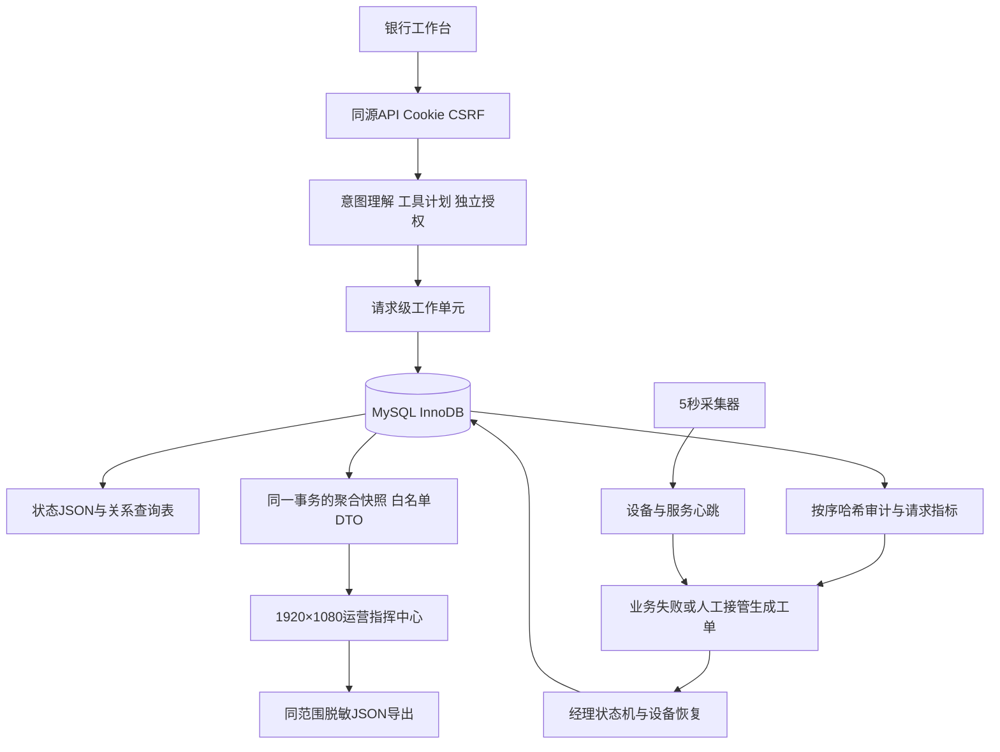

# MySQL与运营大屏技术说明

版本3.0，2026-11-01。面向银行领导与银行经理，设计画布1920×1080。

## 交付范围与数据性质

当前交付MySQL持久化、运营指标查询、动态大屏、工单状态机、设备与业务联动、角色校验及脱敏导出。保留原有六类金融场景、30项工具、DAG、累计金额分级、用户确认、模拟强验证与防重放。

银行、客户、交易、网点、终端与演练工单均为模拟。真实测量项仅包括本机主机CPU/内存、应用采集进程存活心跳，以及实际MySQL查询时延。真实应用请求是指当前沙箱应用实际收到的请求，不能解释为真实银行客户业务。演练流生成的请求明确标记synthetic，和规则、模型、回退来源分开计数。没有接入真实ATM、银行生产核心、短信或商户。

## 架构与事务

MySQL默认数据库名root、连接账号root，满足本机配置；密码由进程环境或启动脚本隐藏输入，不写入源码。仅创建zx_前缀表，不读取或修改同实例其他业务数据库。

业务状态保留一份完整JSON以兼容既有业务模型，同时建立账户、交易与资源关系查询表。真正发生状态变更时，状态JSON、关系查询表、审计、请求指标和自动复核工单在同一InnoDB事务内提交。纯查询只追加审计与请求，不重复重建关系表。所有SQL值使用参数绑定，数据库标识符另做白名单校验。

HTTP成功响应在数据库提交完成后发送。SQL异常或连接不可用时回滚数据库事务，并恢复本次内存业务状态、会话和审计尾部，不切换到JSON继续扣款。状态采用数据库版本比较，拒绝其他服务进程造成的旧版本覆盖。金融计划仍检查原有内存业务修订号。

系统当前支持单业务服务实例，关系查询表在业务变更时整体投影，适合本机小规模赛事沙箱。未实现生产级多进程账本、清算对账、外部金融API幂等及数据库提交确认丢失后的自动对账恢复，不宣称银行级恰好一次。更大规模需改为领域级增量DML、独立事务账本及持久幂等业务号。

## 数据表和迁移

|表|内容|主要关联|
|---|---|---|
|zx_schema_version|结构及演练数据迁移版本|版本1初始、2审计序号、3演练维度解耦、4审计精确文本|
|zx_bank_state|单实例多账户完整状态JSON、版本、更新时间|id=1|
|zx_users|客户掩码姓名、手机号与演示网点|user_id、branch_id|
|zx_accounts|掩码账号、DECIMAL余额、币种|user_id、branch_id|
|zx_transactions|交易金额、方向、类别、渠道及时间|txn_id、user_id、branch_id|
|zx_resources|产品、持仓、卡片、订阅、订单、预约与定时任务|kind、resource_id、owner_id|
|zx_audit_log|LONGTEXT保存精确序列化正文，sequence_id排序哈希事件链|hash、operation、step_id|
|zx_requests|服务请求、匿名会话别名、来源、场景、状态和耗时|request_id、branch_id|
|zx_devices|设备及服务的最新心跳|device_id、branch_id|
|zx_device_samples|设备历史监测点|device_id、event_ts|
|zx_work_orders|工单、关联设备、状态、SLA和版本|ticket_id、source_key、device_id|
|zx_ops_events|分派、处理、解决和设备恢复的运营审计|ref_id关联ticket_id|

结构定义见database/schema.sql，脚本scripts/init_mysql.py负责幂等创建和一次性导入。已经存在数据库状态时以数据库为准，不再用旧JSON覆盖。原文件保留，数据库初始化不会删除它。设备历史样本保留24小时，金融流水和审计不按该规则清理。

## 模块联动与角色

1. 转账、账单、理财、卡片、订阅与生日业务继续由原Agent授权执行；真实应用交互写入zx_requests，确认请求沿用初始计划的模型/规则来源。
2. 业务执行失败或选择人工接管时，审计生成唯一source_key的复核工单，重复来源不会重复建单。
3. 演练设备预警生成关联设备与网点的工单。经理可查看设备明细，再分派、开始处理、恢复演练设备和提交处理结果。
4. 工单按NEW → ASSIGNED → IN_PROGRESS → RESOLVED流转。每次写操作携带版本；旧页面重复提交或另一人先处理时，服务端返回冲突。设备工单解决前必须有正常、20秒内的心跳。
5. 所有运营操作写入zx_ops_events。操作工单不会自动冻结卡、转账或修改金融授权，不绕过赛事权限分级。

领导默认只读；经理使用独立OPS_MANAGER_PASSWORD，未提供时自动生成并保存在忽略的.runtime/ops_manager_code.txt。服务端将角色绑定浏览器Cookie，前端传role字段不能提权。写操作仍要求CSRF，5次口令失败锁定该浏览器60秒；服务重启清除经理角色。该机制是本机演示角色控制，不等于生产IAM或真实员工身份认证。

## 大屏、交互与口径

界面沿用银行常见蓝白配色，以深蓝协同流向区形成主次。六项顶部指标、六张交互图表、设备明细、数字员工表现和优先工单队列共同覆盖四项核心关注。金额与笔数分轴并标单位，空分母显示“—”，没有请求的响应时段保持空值，不能用0毫秒填补。

|模块|指标与来源|交互|
|---|---|---|
|业务运营|流水笔数及入出账金额，zx_transactions|今日/近7日/近30日、网点联动|
|协同流向|请求来源 → 数字员工 → 成功/待确认/失败，zx_requests|点击数字员工查看表现与工作台入口|
|网点负载|各网点请求与待办工单|点击柱条联动全局网点筛选|
|工单效率|工单状态分布、已解决SLA、超时与处理时长|队列详情、经理状态操作|
|设备状态|当前设备状态、心跳、实测本地服务|查看来源、延迟与关联工单|
|AI数字员工|六类业务及必要时的通用澄清服务|成功/待确认/失败、来源拆分|
|服务节奏|最近24小时请求量与平均请求时长|悬停读取精确值|

流水金额为入账与出账绝对金额之和，不能称为银行收入或利润。SLA达标率是所选期间创建且已解决、总处理时长未超SLA的工单数，除以该期间创建且已解决的工单数；未解决超时单独显示。P1 30分钟、P2 120分钟是本项目演练策略，不是赛事规定或银行服务承诺。

历史类图表按相同网点和创建期间筛选；设备为当前快照。近7日指北京时间今日及此前6个自然日。最近24小时节奏图是这批已筛选请求中的最近24小时，不把更早时间段改成新时间标签。初始演练请求420条、工单64条、设备48台，种子20261101；数据分布不代表真实银行经营质量。当前应用实际服务心跳另有2个节点。

前端每5秒取后端MySQL一致性快照，没有浏览器端随机造数。经理可开关演练事件流，演练只写运营请求/工单，不更改银行余额。设备心跳持续采集；采集或连接过期时保留最后快照并显示中断/过期状态，不继续标为实时。页面支持全屏、键盘操作、筛选重置、指标来源查看、详情抽屉和同范围脱敏导出。

## 脱敏与数据最小化

运营接口采用服务端字段白名单，不读取并返回完整银行状态、原始对话或客户名单；大屏和导出不包含姓名、手机号、账号、证件号、设备IP、会话ID、密钥和确认token。SQL客户查询表只保存掩码姓名、手机号与账号。工单处理说明在写库前替换已知模拟客户姓名，并屏蔽手机号、长账号和常见密钥表达。

完整业务JSON仍含用于沙箱联系人匹配的模拟标识，位于受限本机数据库内部，不代表进行了全库加密或生产数据匿名化。外部接入真实个人数据前需另行完成授权、字段加密、最小权限、审计及数据生命周期设计。

## 验证与使用边界

原业务安全45项和HTTP15项通过。MySQL与运营新增检查覆盖原子提交、故障回滚、版本冲突、审计顺序、维度汇总、SLA分母、脱敏、经理权限、CSRF、设备工单、5秒数据变化及重启恢复。准确项目数以evidence/mysql_ops_results.json为准。测试在唯一zx_test_随机数据库运行并清理，未清理root演示库。

仍未实现真实银行清算、短信MFA、APP/IM连接器、真实工单客服平台、真实设备协议和物理机器人。本项目为受控数字银行环境行动闭环；运营大屏是对该系统的补充，不替代银行AI智能体赛题本身。

## 公开赛事参考与独立实现

核对2026官网国内赛道“AI代人操作银行”的安全及体验方向，继续保留金融意图、规划和受控执行要求。参考港科大（广州）发布的2025获奖作品《灵操盘》和《FinAgent》公开介绍，提取自然语言、可执行链路、风控与可验证结果的设计启发；没有获得、复制或声称复现获奖团队源码及性能。技术、界面和演练数据为本项目独立实现。

来源：[赛事官网](https://fintechathon.g-ican.com/)；[港科大（广州）2025获奖介绍](https://www.hkust-gz.edu.cn/zh/2025/12/17/喜报！我校学子荣获2025-fintechathon深圳国际金融科技大赛金/)；[MySQL事务文档](https://dev.mysql.com/doc/connector-python/en/connector-python-api-mysqlconnection-commit.html)。

## 审计格式迁移说明

初次MySQL集成发现，二进制JSON可能规范化浮点数文本，早期表在补加自增序号时也不保证原插入顺序。v4迁移将审计与运营事件正文改为LONGTEXT保存精确JSON文本。已存在的早期35条SQL记录连同保留的原始文件记录完整归档到zx_ops_events，归档摘要与新审计链的迁移锚核对一致，没有更改余额或交易结果，也没有重新伪造旧事件的验证结论。迁移后每次启动严格核验新链，后续链损坏将拒绝启动，不再自动归档绕过。详见evidence/audit_storage_migration.json。
