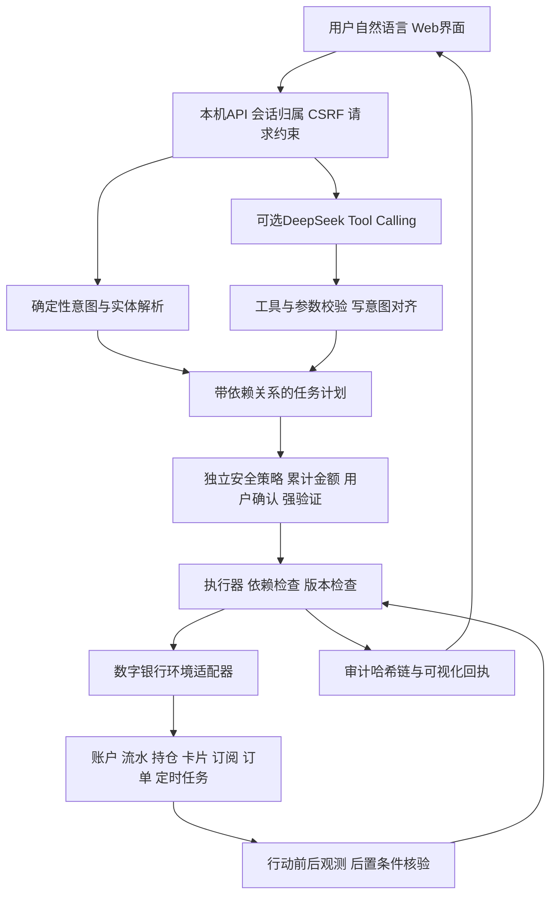
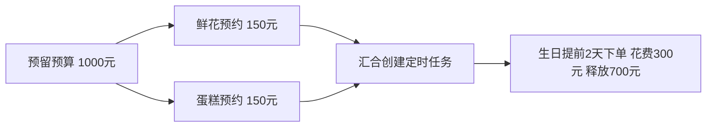

# 技术文档 知行银行智能体

## 项目概述与赛事定位

知行构建面向零售银行的数字环境智能体，以自然语言解析需求，以受约束工具调用生成任务，以独立策略授权行动，并通过实际状态验证结果。系统覆盖转账、账单、理财、卡片、订阅及生日联动六个核心方向的主要链路。可视化界面将对话、任务DAG、环境观测与业务数据放在同一工作空间。

本项目仅提交国内人工智能赛道“银行AI智能体”。依据目录中的规则截图及2026-10-31官网核验，硬性要求为至少三个核心方向、分级权限、安全机制、DAG及中断回退、技术文档、10分钟以内PPT、5分钟以内演示、源码部署用例与安全自评。完整对应见《规则核对与提交清单》。没有从旧原型文档沿用未经证实的评分权重。

项目基于原目录既有原型进行重构，保留Python标准库运行方式和本地ECharts，强化授权边界、计划依赖、环境核验和交付证据。源代码和材料使用AI辅助开发，参赛团队需进行最终审阅和权属确认。

## 系统架构

渠道层当前交付Web应用与REST API，供后续APP或IM适配。没有把未接入的外部渠道写成已交付功能。编排层使用显式状态与工具注册，模型不能执行任意代码或直接修改账本。业务状态与审计分别保存在本地，服务进程串行处理请求，核心使用互斥锁；这些设计满足本机演示可复现性，但不等于分布式金融事务。

## 感知行动与数字具身设计

本项目把“更具身”落实为数字银行环境中的感知、行动与反馈：Agent先观测可用余额、预留、持仓、卡片、订阅、订单和定时任务，再规划工具动作。执行后再次读取环境，对转账扣款、预留增加、持仓变化、卡片目标状态、预约与任务存在性进行后置检查。结果不从模型生成的自然语言取得，而由业务回执与实际状态组成。

环境观测包含environment、observed_at、balance、held、daily_committed、cards、holdings、subscriptions、orders和scheduled。动作包含固定的30项银行工具。模型可以提议动作，但授权层、工具参数白名单与状态机独立运行。当前没有物理传感器、机器人本体、视觉导航或真实银行设备，所述能力是数字环境中的行动闭环。

## 意图理解与工具规划算法

离线路由识别场景关键词和转账强信号，抽取姓名、手机号或备注、金额、币种、日期、产品、卡片及订阅。金额解析先识别带货币单位的数值，避免把手机号和90天等产品期限当金额；支持“两千五百二十一元”等中文金额。缺少金额或实体时要求澄清。当前不支持复杂任意指代或重复周期定时转账，明确提示边界。

大模型模式使用DeepSeek Chat Completions的Function Calling。工具Schema由同一注册表导出，声明工具名称、参数类型、必填项和additionalProperties=false。应用层仍校验所有参数，不能依赖模型或Schema本身代替业务验证。接口采用非思考工具规划，未实现带思维内容往返的多轮推理协议，因此界面称“工具规划”，不再标“深度思考”。

模型提议的写操作须属于用户确定性候选意图。金额、收款人、产品和卡片与用户明确表达及当前资源对齐；不符合时停止并追问。未知工具和额外参数直接拒绝。工具调用失败或模型服务不可用时回退规则模式，返回planner_source区分实际来源。启用模型时仅发送必要的模拟上下文。查询结果与操作回执仍直接取自银行工具。

## DAG与生命周期

计划步骤包含step_id、operation、params、depends_on、risk、strategy、status、result。生成随机计划前缀，避免旧UI的s1确认授权到新的s1。执行器检查唯一ID和依赖顺序，拒绝悬空依赖和环；依赖失败会跳过后继节点。当前执行器按拓扑序串行调度，生日的两个预约分支在图中独立，未宣称并发加速。

步骤状态包括pending、await_confirm、executed、failed、skipped、cancelled及rolled_back。中高风险节点等待确认。暂停会撤销待验证挑战，继续时重新生成；人工接管生成本地记录。确认前若状态版本已因其他会话或定时任务变化，暂停旧计划，避免旧快照覆盖新业务。

跨场景生日示例：识别“李婷2026-11-10生日，预留1000元买鲜花蛋糕”，解析收礼人、生日与预算；授权后从可用资金预留1000元；创建鲜花和蛋糕各150元的两笔预约；汇合后创建生日提前2天的模拟定时任务。到期花费300元并释放700元。预约和下单严格区分，当前只涉及沙箱商户。

如某个预约失败，后继停止，恢复本计划起点的沙箱状态并保留失败审计。若其他动作已修改全局状态，转人工接管。真实已结算转账必须由银行服务执行补偿，不能沿用该快照回退方式。

## 六个场景实现

|方向|例句|主要工具及结果|
|---|---|---|
|转账|给李婷转500元，备注餐费|transfer，确认后更新双方模拟账户并写交易流水|
|账单|分析本月账单并检查异常|monthly_report、bill_analysis、detect_anomaly，分类收支与疑似交易|
|理财|推荐稳健理财，申购货币基金100元|wealth_recommend、risk_assess、subscribe/redeem，强验证、风险匹配和期限检查|
|卡片|挂失信用卡、调整借记卡限额|report_loss、adjust_limit、toggle_lock，资源归属及卡状态限制|
|订阅|查看续费、取消视频会员|subscription_list、cancel_subscription，取消后读取最新状态|
|联动|生日预留1000元买鲜花蛋糕|reserve_budget、place_gift_order、finalize_birthday，预算及预约DAG|

问卷三题需要用户给出A/B/C，缺答案时不生成风险得分。产品均为虚构示例，浮动收益保持空值，不作为零收益绘制。封闭期产品在模拟期限未满时禁止赎回。订阅通过协议和代扣流水商户名匹配，并展示续费时间及匹配笔数。AA收款未实现，详见能力边界表。

## 多源数据与可视化

模拟数据包含360笔交易、4种产品、2条初始持仓、2张卡、3项订阅与3笔订单，扩充随机种子为2026，历史截至2026-10-31。保留原型10笔样本。账户初始余额86532.50元属于独立模拟快照，历史交易不作为其会计对账依据。交易跨2026年1月至10月，支持自然月与自然年统计。

数据通过user_id、product_id、merchant、reservation_id关联。dashboard_baseline.json保存可复现聚合，六个CSV与JSON快照供检查。不存在官方提供的真实客户数据集，不把模拟样本的异常识别结果视作真实欺诈检出率。

|图表|组合数据|表达内容|
|---|---|---|
|月度收支折柱图|流水与业务月份|自然月收入和支出|
|消费环图|交易与消费类别|全样本支出去向|
|渠道柱状图|流水与渠道|各渠道支出金额|
|时段热力图|时间、星期及支出|北京时间消费时段分布|
|产品柱状图|产品风险与示例年化|可数字化产品比较|
|持仓环图|持仓与产品标识|本金和流动性结构|
|卡片堆积图|卡片类型、已用量、限额|日限额或授信使用|
|订阅月等效图|订阅周期与协议金额|年费除12后的可比支出|
|续费图|协议日期与代扣流水|距扣费天数及匹配笔数|
|订单金额图|商品、订单与预约ID|交易及生日预约金额|
|审计风险图|实际审计与权限级别|本进程事件分布|
|异常散点图|流水时间、金额与异常规则|需要核实的交易线索|

每个视图标注模拟属性和口径。审计数量不是风险防御成功率；规则异常不构成欺诈认定；年化示例不保证回报。前端使用本地ECharts，不依赖CDN。会话结果图使用同一业务回执，避免图表与实际状态不一致。

## 安全与权限策略

规则截图要求低风险自动、一般风险确认、高风险强验证。转账和预算承诺在北京时间当日累计，≤1000元需确认，>1000元需密码及本地模拟一次性验证码；申购、赎回、挂失、补发和解冻强验证。累计窗口为工程选择，截图未规定唯一窗口，须在赛事平台有更新通知时调整。

确认绑定会话、唯一步骤和参数摘要，挑战180秒到期、使用后失效。三次失败锁定模拟账户，新建会话不能解锁。币种金额换算后参与累计，拒绝负数、零、NaN、无穷、布尔金额与过多小数。工具仅操作当前演示账户资源，跨浏览器session_id拒绝。

HTTP限制同源和Host，使用Cookie及CSRF，限制请求大小、JSON类型和静态文件路径。模型不能通过请求参数覆写账户主体，也没有任意代码执行入口。审计包含操作、风险、依赖和核验，密码验证码不落日志。完整已知风险见《安全自评报告》。

## 验证结果与可复现性

45项业务安全回归通过，覆盖1000元边界、累计和外币、理财红色权限、确认防重放、三次失败锁定、缺参澄清、卡片资源、DAG汇合、定时重复、部分失败回退、模型错误与幻觉约束。15项HTTP集成通过，覆盖同源、CSRF、跨浏览器、类型、请求大小、路径与状态重启。

已完成一次真实DeepSeek只读工具调用，返回query_balance，原始结果只记录模型名、工具名、耗时与成功标志，未保存密钥。此证据不替代完整在线端到端业务评测。页面通过Edge实际加载，12个图表成功初始化，未发现JavaScript运行异常。

所有结果在evidence目录，复现命令在README。视频展示当前界面的实际操作和模拟业务结果。PPT包含原生可编辑图表与架构图，讲稿规划9分钟以内。

## 局限与后续工作

当前实现为单演示账户、本机服务、内存会话、JSON状态和文件审计。生产需要独立认证、真实MFA、数据库事务、银行幂等及对账，不能把演示验证码作为真实身份因子。人工接管只留本地待办，订阅提醒仅在界面展示。模型意图路由的小样本验证不支持泛化准确率结论。

优先补强授权与事务，再扩展APP/IM、AA收款及真实商户库存、地址和交付。真实物理具身需要另行建设传感器、本体和安全控制，不属于当前实现。赛题材料中未规定这些扩展必须完成，本次如实标注。

## 参考资料与来源

赛事规则截图：工作目录两张PNG与本次附图。官网：https://fintechathon.g-ican.com/ ，核验日期2026-10-31。DeepSeek工具文档：https://api-docs.deepseek.com/guides/tool_calls/ 。模型说明：https://api-docs.deepseek.com/quick_start/pricing/ 。ECharts：https://echarts.apache.org/ 。第三方软件协议及来源见开源说明。未实际采用的OpenCow等旧引用已删除。
