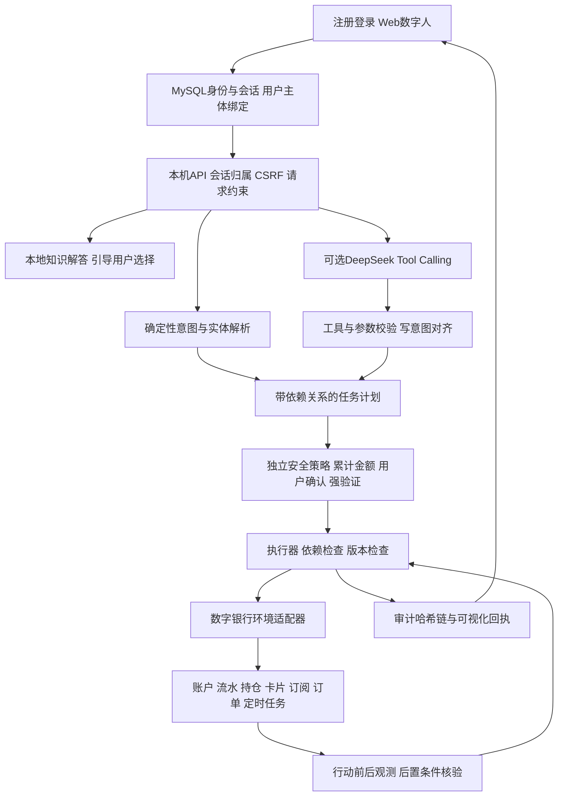
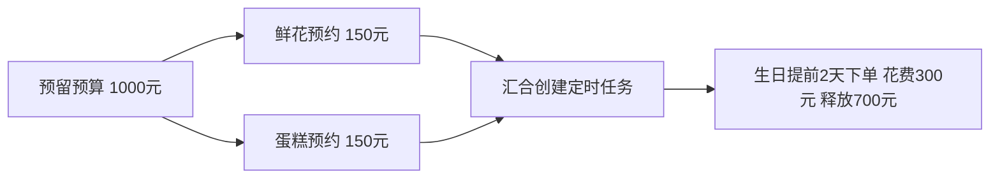
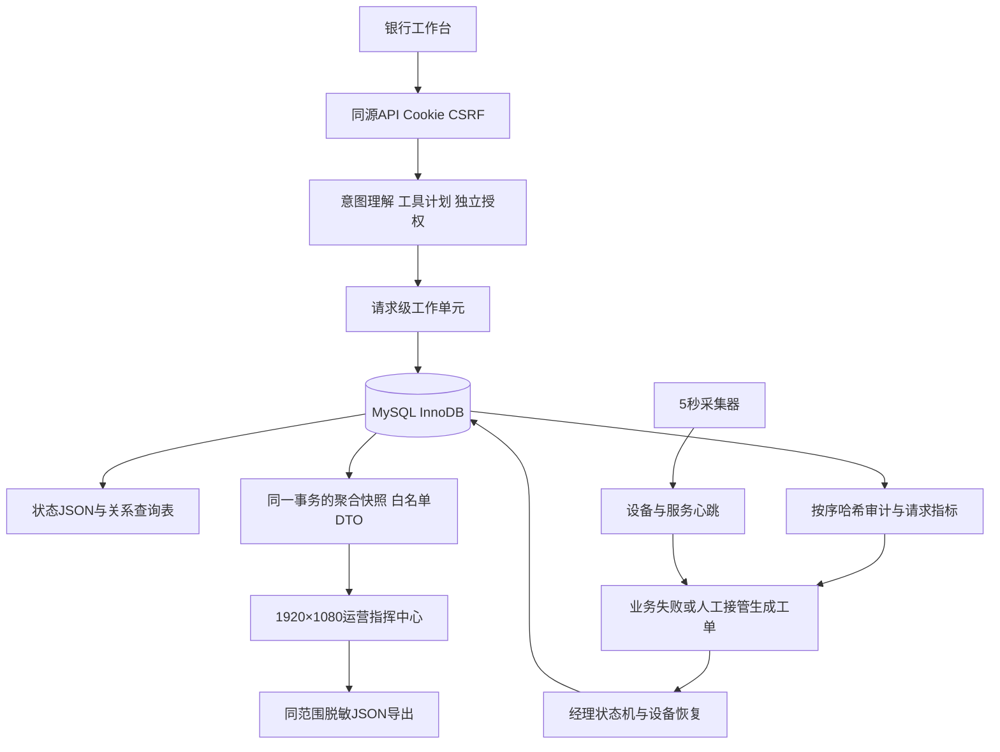

# 技术文档 知行银行智能体 v4.0

## 项目概述与赛事定位

知行构建面向零售银行的数字环境智能体，以自然语言解析需求，以受约束工具调用生成任务，以独立策略授权行动，并通过实际状态验证结果。系统覆盖转账、账单、理财、卡片、订阅及生日联动六个核心方向的主要链路。可视化界面将对话、任务DAG、环境观测与业务数据放在同一工作空间。v4增加独立账户注册登录、原创数字人服务厅及跨页面会话恢复。

本项目仅提交国内人工智能赛道“银行AI智能体”。依据目录中的规则截图及2026-10-31官网核验，硬性要求为至少三个核心方向、分级权限、安全机制、DAG及中断回退、技术文档、10分钟以内PPT、5分钟以内演示、源码部署用例与安全自评。完整对应见《规则核对与提交清单》。没有从旧原型文档沿用未经证实的评分权重。

项目基于原目录既有原型进行重构，保留Python标准库运行方式和本地ECharts，强化授权边界、计划依赖、环境核验和交付证据。源代码和材料使用AI辅助开发，参赛团队需进行最终审阅和权属确认。

## 系统架构

渠道层当前交付Web应用与REST API，供后续APP或IM适配。没有把未接入的外部渠道写成已交付功能。编排层使用显式状态与工具注册，模型不能执行任意代码或直接修改账本。推荐模式以MySQL工作单元事务提交业务状态、关系查询表、审计和运营请求；原JSON模式仅作显式兼容验证。服务使用串行化业务锁和数据库版本检查；单实例演示不等于生产分布式金融事务。

## 感知行动与数字具身设计

本项目把“更具身”落实为数字银行环境中的感知、行动与反馈：Agent先观测可用余额、预留、持仓、卡片、订阅、订单和定时任务，再规划工具动作。执行后再次读取环境，对转账扣款、预留增加、持仓变化、卡片目标状态、预约与任务存在性进行后置检查。结果不从模型生成的自然语言取得，而由业务回执与实际状态组成。

环境观测包含environment、observed_at、balance、held、daily_committed、cards、holdings、subscriptions、orders和scheduled。动作包含固定的30项银行工具。模型可以提议动作，但授权层、工具参数白名单与状态机独立运行。当前没有物理传感器、机器人本体、视觉导航或真实银行设备，所述能力是数字环境中的行动闭环。

## 意图理解与工具规划算法

离线路由识别场景关键词和转账强信号，抽取姓名、手机号或备注、金额、币种、日期、产品、卡片及订阅。金额解析先识别带货币单位的数值，避免把手机号和90天等产品期限当金额；支持“两千五百二十一元”等中文金额。缺少金额或实体时要求澄清。当前不支持复杂任意指代或重复周期定时转账，明确提示边界。

大模型模式使用DeepSeek Chat Completions的Function Calling。工具Schema由同一注册表导出，声明工具名称、参数类型、必填项和additionalProperties=false。应用层仍校验所有参数，不能依赖模型或Schema本身代替业务验证。接口采用非思考工具规划，未实现带思维内容往返的多轮推理协议，因此界面称“工具规划”，不再标“深度思考”。

模型提议的写操作须属于用户确定性候选意图。金额、收款人、产品和卡片与用户明确表达及当前资源对齐；不符合时停止并追问。未知工具和额外参数直接拒绝。工具调用失败或模型服务不可用时回退规则模式，返回planner_source区分实际来源。启用模型时仅发送必要的模拟上下文。查询结果与操作回执仍直接取自银行工具。

## DAG与生命周期

计划步骤包含step_id、operation、params、depends_on、risk、strategy、status、result。生成随机计划前缀，避免旧UI的s1确认授权到新的s1。执行器检查唯一ID和依赖顺序，拒绝悬空依赖和环；依赖失败会跳过后继节点。当前执行器按拓扑序串行调度，生日的两个预约分支在图中独立，未宣称并发加速。

步骤状态包括pending、await_confirm、executed、failed、skipped、cancelled及rolled_back。中高风险节点等待确认。暂停会撤销待验证挑战，继续时重新生成；人工接管生成本地记录。确认前若状态版本已因其他会话或定时任务变化，暂停旧计划，避免旧快照覆盖新业务。

跨场景生日示例：识别“李婷2026-11-10生日，预留1000元买鲜花蛋糕”，解析收礼人、生日与预算；授权后从可用资金预留1000元；创建鲜花和蛋糕各150元的两笔预约；汇合后创建生日提前2天的模拟定时任务。到期花费300元并释放700元。预约和下单严格区分，当前只涉及沙箱商户。

如某个预约失败，后继停止，恢复本计划起点的沙箱状态并保留失败审计。若其他动作已修改全局状态，转人工接管。真实已结算转账必须由银行服务执行补偿，不能沿用该快照回退方式。

## 六个场景实现

|方向|例句|主要工具及结果|
|---|---|---|
|转账|给李婷转500元，备注餐费|transfer，确认后更新双方模拟账户并写交易流水|
|账单|分析本月账单并检查异常|monthly_report、bill_analysis、detect_anomaly，分类收支与疑似交易|
|理财|推荐稳健理财，申购货币基金100元|wealth_recommend、risk_assess、subscribe/redeem，强验证、风险匹配和期限检查|
|卡片|挂失信用卡、调整借记卡限额|report_loss、adjust_limit、toggle_lock，资源归属及卡状态限制|
|订阅|查看续费、取消视频会员|subscription_list、cancel_subscription，取消后读取最新状态|
|联动|生日预留1000元买鲜花蛋糕|reserve_budget、place_gift_order、finalize_birthday，预算及预约DAG|

问卷三题需要用户给出A/B/C，缺答案时不生成风险得分。产品均为虚构示例，浮动收益保持空值，不作为零收益绘制。封闭期产品在模拟期限未满时禁止赎回。订阅通过协议和代扣流水商户名匹配，并展示续费时间及匹配笔数。AA收款未实现，详见能力边界表。

## 多源数据与可视化

模拟数据包含360笔交易、4种产品、2条初始持仓、2张卡、3项订阅与3笔订单，扩充随机种子为2026，历史截至2026-10-31。保留原型10笔样本。账户初始余额86532.50元属于独立模拟快照，历史交易不作为其会计对账依据。交易跨2026年1月至10月，支持自然月与自然年统计。

数据通过user_id、product_id、merchant、reservation_id关联。dashboard_baseline.json保存可复现聚合，六个CSV与JSON快照供检查。不存在官方提供的真实客户数据集，不把模拟样本的异常识别结果视作真实欺诈检出率。

|图表|组合数据|表达内容|
|---|---|---|
|月度收支折柱图|流水与业务月份|自然月收入和支出|
|消费环图|交易与消费类别|全样本支出去向|
|渠道柱状图|流水与渠道|各渠道支出金额|
|时段热力图|时间、星期及支出|北京时间消费时段分布|
|产品柱状图|产品风险与示例年化|可数字化产品比较|
|持仓环图|持仓与产品标识|本金和流动性结构|
|卡片堆积图|卡片类型、已用量、限额|日限额或授信使用|
|订阅月等效图|订阅周期与协议金额|年费除12后的可比支出|
|续费图|协议日期与代扣流水|距扣费天数及匹配笔数|
|订单金额图|商品、订单与预约ID|交易及生日预约金额|
|审计风险图|实际审计与权限级别|当前账户已保存事件分布|
|异常散点图|流水时间、金额与异常规则|需要核实的交易线索|

每个视图标注模拟属性和口径。审计数量不是风险防御成功率；规则异常不构成欺诈认定；年化示例不保证回报。前端使用本地ECharts，不依赖CDN。会话结果图使用同一业务回执，避免图表与实际状态不一致。

## 安全与权限策略

规则截图要求低风险自动、一般风险确认、高风险强验证。转账和预算承诺在北京时间当日累计，≤1000元需确认，>1000元需密码及本地模拟一次性验证码；申购、赎回、挂失、补发和解冻强验证。累计窗口为工程选择，截图未规定唯一窗口，须在赛事平台有更新通知时调整。

确认绑定会话、唯一步骤和参数摘要，挑战180秒到期、使用后失效。三次失败锁定模拟账户，新建会话不能解锁。币种金额换算后参与累计，拒绝负数、零、NaN、无穷、布尔金额与过多小数。工具仅操作当前演示账户资源，跨浏览器session_id拒绝。

HTTP限制同源和Host，使用Cookie及CSRF，限制请求大小、JSON类型和静态文件路径。模型不能通过请求参数覆写账户主体，也没有任意代码执行入口。审计包含操作、风险、依赖和核验，密码验证码不落日志。完整已知风险见《安全自评报告》。

## 验证结果与可复现性

45项业务安全回归通过，覆盖1000元边界、累计和外币、理财红色权限、确认防重放、三次失败锁定、缺参澄清、卡片资源、DAG汇合、定时重复、部分失败回退、模型错误与幻觉约束。15项HTTP集成通过，覆盖同源、CSRF、跨浏览器、类型、请求大小、路径与状态重启。

已完成一次真实DeepSeek只读工具调用，返回query_balance，原始结果只记录模型名、工具名、耗时与成功标志，未保存密钥。此证据不替代完整在线端到端业务评测。页面通过Edge实际加载，12个图表成功初始化，未发现JavaScript运行异常。

所有结果在evidence目录，复现命令在README。视频展示当前界面的实际操作和模拟业务结果。PPT包含原生可编辑图表与架构图，讲稿规划9分钟以内。

## 局限与后续工作

当前实现为独立注册模拟账户及显式共享演示身份、本机单实例服务、MySQL登录会话、内存对话、事务及关系查询表。数据库异常回退本次内存状态，审计按序持久化。运营新增经理权限和工单队列。生产仍需要独立IAM、真实MFA、清算幂等和对账，不能把演示验证码作为真实身份因子。人工接管产生本机复核工单，未连接外部客服；订阅提醒仅在界面展示。模型意图路由的小样本验证不支持泛化准确率结论。

优先补强授权与事务，再扩展APP/IM、AA收款及真实商户库存、地址和交付。真实物理具身需要另行建设传感器、本体和安全控制，不属于当前实现。赛题材料中未规定这些扩展必须完成，本次如实标注。

## 参考资料与来源

赛事规则截图：工作目录两张PNG与本次附图。官网：https://fintechathon.g-ican.com/ ，核验日期2026-10-31。DeepSeek工具文档：https://api-docs.deepseek.com/guides/tool_calls/ 。模型说明：https://api-docs.deepseek.com/quick_start/pricing/ 。ECharts：https://echarts.apache.org/ 。第三方软件协议及来源见开源说明。未实际采用的OpenCow等旧引用已删除。

# MySQL与运营大屏扩展设计

版本3.0，2026-11-01。面向银行领导与银行经理，设计画布1920×1080。

## 交付范围与数据性质

当前交付MySQL持久化、运营指标查询、动态大屏、工单状态机、设备与业务联动、角色校验及脱敏导出。保留原有六类金融场景、30项工具、DAG、累计金额分级、用户确认、模拟强验证与防重放。

银行、客户、交易、网点、终端与演练工单均为模拟。真实测量项仅包括本机主机CPU/内存、应用采集进程存活心跳，以及实际MySQL查询时延。真实应用请求是指当前沙箱应用实际收到的请求，不能解释为真实银行客户业务。演练流生成的请求明确标记synthetic，和规则、模型、回退来源分开计数。没有接入真实ATM、银行生产核心、短信或商户。

## 架构与事务

MySQL默认数据库名root、连接账号root，满足本机配置；密码由进程环境或启动脚本隐藏输入，不写入源码。仅创建zx_前缀表，不读取或修改同实例其他业务数据库。

业务状态保留一份完整JSON以兼容既有业务模型，同时建立账户、交易与资源关系查询表。真正发生状态变更时，状态JSON、关系查询表、审计、请求指标和自动复核工单在同一InnoDB事务内提交。纯查询只追加审计与请求，不重复重建关系表。所有SQL值使用参数绑定，数据库标识符另做白名单校验。

HTTP成功响应在数据库提交完成后发送。SQL异常或连接不可用时回滚数据库事务，并恢复本次内存业务状态、会话和审计尾部，不切换到JSON继续扣款。状态采用数据库版本比较，拒绝其他服务进程造成的旧版本覆盖。金融计划仍检查原有内存业务修订号。

系统当前支持单业务服务实例，关系查询表在业务变更时整体投影，适合本机小规模赛事沙箱。未实现生产级多进程账本、清算对账、外部金融API幂等及数据库提交确认丢失后的自动对账恢复，不宣称银行级恰好一次。更大规模需改为领域级增量DML、独立事务账本及持久幂等业务号。

## 数据表和迁移

|表|内容|主要关联|
|---|---|---|
|zx_schema_version|结构及演练数据迁移版本|版本1初始、2审计序号、3演练维度解耦|
|zx_bank_state|单实例多账户完整状态JSON、版本、更新时间|id=1|
|zx_users|客户掩码姓名、手机号与演示网点|user_id、branch_id|
|zx_accounts|掩码账号、DECIMAL余额、币种|user_id、branch_id|
|zx_transactions|交易金额、方向、类别、渠道及时间|txn_id、user_id、branch_id|
|zx_resources|产品、持仓、卡片、订阅、订单、预约与定时任务|kind、resource_id、owner_id|
|zx_audit_log|按sequence_id排序的哈希事件链|hash、operation、step_id|
|zx_requests|服务请求、匿名会话别名、来源、场景、状态和耗时|request_id、branch_id|
|zx_devices|设备及服务的最新心跳|device_id、branch_id|
|zx_device_samples|设备历史监测点|device_id、event_ts|
|zx_work_orders|工单、关联设备、状态、SLA和版本|ticket_id、source_key、device_id|
|zx_ops_events|分派、处理、解决和设备恢复的运营审计|ref_id关联ticket_id|

结构定义见database/schema.sql，脚本scripts/init_mysql.py负责幂等创建和一次性导入。已经存在数据库状态时以数据库为准，不再用旧JSON覆盖。原文件保留，数据库初始化不会删除它。设备历史样本保留24小时，金融流水和审计不按该规则清理。

## 模块联动与角色

1. 转账、账单、理财、卡片、订阅与生日业务继续由原Agent授权执行；真实应用交互写入zx_requests，确认请求沿用初始计划的模型/规则来源。
2. 业务执行失败或选择人工接管时，审计生成唯一source_key的复核工单，重复来源不会重复建单。
3. 演练设备预警生成关联设备与网点的工单。经理可查看设备明细，再分派、开始处理、恢复演练设备和提交处理结果。
4. 工单按NEW → ASSIGNED → IN_PROGRESS → RESOLVED流转。每次写操作携带版本；旧页面重复提交或另一人先处理时，服务端返回冲突。设备工单解决前必须有正常、20秒内的心跳。
5. 所有运营操作写入zx_ops_events。操作工单不会自动冻结卡、转账或修改金融授权，不绕过赛事权限分级。

领导默认只读；经理使用独立OPS_MANAGER_PASSWORD，未提供时自动生成并保存在忽略的.runtime/ops_manager_code.txt。服务端将角色绑定浏览器Cookie，前端传role字段不能提权。写操作仍要求CSRF，5次口令失败锁定该浏览器60秒；服务重启清除经理角色。该机制是本机演示角色控制，不等于生产IAM或真实员工身份认证。

## 大屏、交互与口径

界面沿用银行常见蓝白配色，以深蓝协同流向区形成主次。六项顶部指标、六张交互图表、设备明细、数字员工表现和优先工单队列共同覆盖四项核心关注。金额与笔数分轴并标单位，空分母显示“—”，没有请求的响应时段保持空值，不能用0毫秒填补。

|模块|指标与来源|交互|
|---|---|---|
|业务运营|流水笔数及入出账金额，zx_transactions|今日/近7日/近30日、网点联动|
|协同流向|请求来源 → 数字员工 → 成功/待确认/失败，zx_requests|点击数字员工查看表现与工作台入口|
|网点负载|各网点请求与待办工单|点击柱条联动全局网点筛选|
|工单效率|工单状态分布、已解决SLA、超时与处理时长|队列详情、经理状态操作|
|设备状态|当前设备状态、心跳、实测本地服务|查看来源、延迟与关联工单|
|AI数字员工|六类业务及必要时的通用澄清服务|成功/待确认/失败、来源拆分|
|服务节奏|最近24小时请求量与平均请求时长|悬停读取精确值|

流水金额为入账与出账绝对金额之和，不能称为银行收入或利润。SLA达标率是所选期间创建且已解决、总处理时长未超SLA的工单数，除以该期间创建且已解决的工单数；未解决超时单独显示。P1 30分钟、P2 120分钟是本项目演练策略，不是赛事规定或银行服务承诺。

历史类图表按相同网点和创建期间筛选；设备为当前快照。近7日指北京时间今日及此前6个自然日。最近24小时节奏图是这批已筛选请求中的最近24小时，不把更早时间段改成新时间标签。初始演练请求420条、工单64条、设备48台，种子20261101；数据分布不代表真实银行经营质量。当前应用实际服务心跳另有2个节点。

前端每5秒取后端MySQL一致性快照，没有浏览器端随机造数。经理可开关演练事件流，演练只写运营请求/工单，不更改银行余额。设备心跳持续采集；采集或连接过期时保留最后快照并显示中断/过期状态，不继续标为实时。页面支持全屏、键盘操作、筛选重置、指标来源查看、详情抽屉和同范围脱敏导出。

## 脱敏与数据最小化

运营接口采用服务端字段白名单，不读取并返回完整银行状态、原始对话或客户名单；大屏和导出不包含姓名、手机号、账号、证件号、设备IP、会话ID、密钥和确认token。SQL客户查询表只保存掩码姓名、手机号与账号。工单处理说明在写库前替换已知模拟客户姓名，并屏蔽手机号、长账号和常见密钥表达。

完整业务JSON仍含用于沙箱联系人匹配的模拟标识，位于受限本机数据库内部，不代表进行了全库加密或生产数据匿名化。外部接入真实个人数据前需另行完成授权、字段加密、最小权限、审计及数据生命周期设计。

## 验证与使用边界

原业务安全45项和HTTP15项通过。MySQL与运营新增检查覆盖原子提交、故障回滚、版本冲突、审计顺序、维度汇总、SLA分母、脱敏、经理权限、CSRF、设备工单、5秒数据变化及重启恢复。准确项目数以evidence/mysql_ops_results.json为准。测试在唯一zx_test_随机数据库运行并清理，未清理root演示库。

仍未实现真实银行清算、短信MFA、APP/IM连接器、真实工单客服平台、真实设备协议和物理机器人。本项目为受控数字银行环境行动闭环；运营大屏是对该系统的补充，不替代银行AI智能体赛题本身。

## 公开赛事参考与独立实现

核对2026官网国内赛道“AI代人操作银行”的安全及体验方向，继续保留金融意图、规划和受控执行要求。参考港科大（广州）发布的2025获奖作品《灵操盘》和《FinAgent》公开介绍，提取自然语言、可执行链路、风控与可验证结果的设计启发；没有获得、复制或声称复现获奖团队源码及性能。技术、界面和演练数据为本项目独立实现。

来源：[赛事官网](https://fintechathon.g-ican.com/)；[港科大（广州）2025获奖介绍](https://www.hkust-gz.edu.cn/zh/2025/12/17/喜报！我校学子荣获2025-fintechathon深圳国际金融科技大赛金/)；[MySQL事务文档](https://dev.mysql.com/doc/connector-python/en/connector-python-api-mysqlconnection-commit.html)。

## v4身份、路由与数字人扩展

|入口|未登录|已登录|交互衔接|
|---|---|---|---|
|/|跳转登录|跳转工作台|默认落点/app|
|/login|账号登录或明确选择演示|跳转白名单目标|成功后轮换Cookie与CSRF|
|/register|注册表单|跳转工作台或允许的目标|成功回登录，保留next，仅临时回填用户名|
|/app|登录后返回/app|智能体工作台|#workspace与#dashboard维护页内状态|
|/assistant|登录后返回/assistant|数字人服务厅|和工作台共享当前对话与待确认任务|
|/ops|登录后返回/ops|仅演示运营身份可访问|普通注册用户回/app，API另行403拦截|

next只接受/app、/assistant、/ops及两个既有工作台锚点；禁止绝对URL、协议相对路径与任意本机路径。登录成功使用replace避免浏览器后退回到已提交表单。所有HTML使用规范入口，/static下的HTML别名不能绕过守卫。受保护API独立校验身份，页面守卫不作为授权依据。

### 注册、凭据与账户隔离

仅收集用户名、服务昵称和登录密码，不采集手机号、证件或生物信息。用户名规范为字母开头、3-32位字母数字下划线，转小写后唯一；昵称2-20位并限制字符。密码12-72位，包含字母与数字，可有空格和符号；确认密码及沙箱说明勾选由服务端复核。

密码使用Python标准库scrypt，N=131072、r=8、p=1、16字节随机盐、32字节输出；常数时间比较派生结果。登录失败给出统一提示，未知用户名也执行KDF。原密码不写入账户JSON、日志、统计、导出或Git。数据库存储哈希并不等于磁盘加密。

注册身份zx_auth_identities与独立银行账户在同一MySQL事务提交，投影失败或重名时恢复内存和数据库，避免孤立账户。新账户余额为0，无历史流水、卡片、持仓、订阅和订单。共享演示身份通过独立按钮显式进入，仍使用原有虚构样本，不等同于注册用户身份。

请求在全局服务锁和核心锁内绑定服务端解析出的user_id，结束时恢复上下文；不接受body指定业务主体。查询、持仓、卡片、订阅、订单、预留、累计承诺、定时任务和安全锁按用户归属筛选。联系人仅暴露预置虚构联系人与本人，注册昵称不会变成其他用户的通讯录。旧记录无owner_id时仅归原演示账户U1001。

数据库现有15张zx_表：v3的12张表加身份、登录会话及失败计数3张表。用户级owner_id包含于原业务状态和资源投影，不重写历史余额或流水。数据库迁移编号5对应新增身份表；历史审计迁移编号4与应用v4版本号是不同概念。

### 会话与访问控制

认证令牌由32字节安全随机数生成，浏览器仅使用HttpOnly、SameSite=Strict、Path=/的会话Cookie。MySQL只保存SHA256令牌摘要、用户归属、创建和活动时间；不使用localStorage保存认证令牌。匿名bank_client仅承担浏览器CSRF及对话归属，拿到匿名Cookie不能访问金融数据。

空闲30分钟或绝对8小时后失效。活动时间最多每30秒更新，避免每个心跳写入。登录轮换浏览器Cookie与CSRF，清空旧浏览器的任务授权入口及经理角色；退出删除当前数据库会话并清除两个Cookie。认证会话可跨服务重启，进程内对话与未完成确认会安全清空；不会重新执行旧确认。已授权的定时任务独立持久化，到期仍按其owner_id执行。

注册来源每分钟最多6次；登录来源每分钟最多40次，账号维度5次错误后剩余60秒窗口内拒绝，包括正确密码。计数存储MySQL、键为摘要，更换浏览器不能绕过账号计数。上述为本机演示限制，不声称抵御分布式攻击。身份注册、登录、拒绝和退出记录匿名事件，不保存提交密码或原始令牌。

运营入口仅向明确选择的演示身份开放领导只读权限，经理操作仍需独立运营口令。普通注册用户不能读取运营聚合或提交运营处置；请求body中的role不能提权。这个安排用于赛事角色演示，生产应接入组织人员目录、租户和岗位授权。

### 原创数字人及行为状态

知小行为原创SVG插画数字形象，采用深蓝制服、浅蓝丝巾及知行胸牌，和登录插画、工作台导航使用同一组件。前端根据服务状态显示待命、理解中、解答中、等待授权、暂停、安全提示和讲解中。呼吸、眨眼和讲解嘴部动画只是界面反馈，不宣称为3D骨骼、音素驱动口型或真实人脸识别。prefers-reduced-motion下关闭动画。

语音默认关闭。只有浏览器提供localService=true的中文语音时才可启用本机讲解；否则自动保留文字服务。可立即停止，页面隐藏或离开时停止。金融结果与待授权详情不朗读具体资金或收款信息；不采集麦克风、摄像头或生物信息，也没有伪装为真人客服的接入。

### 智能问答、意图理解与办理

本地10个知识主题覆盖服务范围、转账、账单、理财、卡片、订阅、注册隐私、生日、安全与运营。咨询识别首先匹配询问语义及领域词，回答仅从已审阅的沙箱说明返回，附KB编号、主题、依据及可选择的后续动作。页面同时展示“理解需求-核对依据-用户选择-分级办理”路径，明确咨询不会产生资金操作。

对明确办理指令，继续使用既有NLU、DAG、安全策略和执行器。例如“如何转账”只解释并给出“开始转账”，点击后“我要转账”会追问缺少的收款人与金额；“给李婷转500元”生成待确认计划，不能因数字人语气而跳过授权。注入文本仍进入同一拦截器。已有待执行计划时，优先处理确认与控制，不能被知识问答覆盖。

可选DeepSeek使用OpenAI兼容工具规划。未知咨询可让模型选择一个知识主题ID，但只接受知识库中的确切ID，不直接展示模型生成的银行政策；分类失败回到明确的范围提示。知识主题选择只发送截断和脱敏后的问题，不发送客户账户。办理规划按需发送现有模拟上下文；仅在用户开启工具规划后启用。

工作台与服务厅通过/api/conversation恢复本浏览器当前会话，包含最后30条历史、咨询来源、后续动作、任务图和当前确认步骤。新对话不能丢弃待授权计划。跨浏览器或退出后的旧session_id无法确认。对话本身暂不入库，避免把完整自然语言与个人秘密变成长期保存记录。

### 验证与实际边界

tests/test_auth_digital.py的44项检查在独立随机MySQL测试库运行，结束只删除本次测试库。包含注册事务故障、重复注册、隔离、Cookie与CSRF轮换、开放重定向、运营越权、咨询不转账、确认归属、路由恢复、登录限流、过期、重启及退出撤销。与既有45项业务、15项HTTP、35项MySQL运营、4项前端状态检查合计143项；最新结果以evidence下JSON为准。

UI检查覆盖1440桌面、1920服务厅及运营画布、820平板、390手机；验证注册错误、成功回登录、目标路由、对话恢复、独立账户、退出及帮助键盘操作。界面截图来自独立演示库，动态数字不是生产经营数据。语音控件与本机语音可用性已检查，未进行真人听感评审。

仍未实现真实银行开户、生产IAM/MFA、短信、自动找回密码、对外HTTPS部署、多实例账本、清算对账、实体机器人或真实商户履约。HTTP仅监听回环地址，Cookie未设置Secure是为了本机HTTP演示；公网生产必须改为HTTPS、Secure Cookie和专用低权限数据库账号。GitHub仅托管代码，不运行Python后端。

完整实现参考与API约束见《注册登录与数字人设计说明》。本轮143项测试均在源码中提供，不把测试数量或静态截图当作生产安全认证。

业务快照回退保留验证失败计数和安全锁；强验证失败也推进状态修订号，防止其他任务的旧快照还原安全状态。失败回执计入运营失败请求，数字人显示安全提示。对应回归同时覆盖本账户取消、跨账户取消及审计归属。

浏览器业务上下文同时绑定用户ID及当前认证令牌摘要，混搭Cookie即使来自同一演示用户，也不能继承其他认证会话的对话或经理权限。前端重新获得焦点或从页面缓存恢复时复核身份，认证上下文变化则刷新页面。
